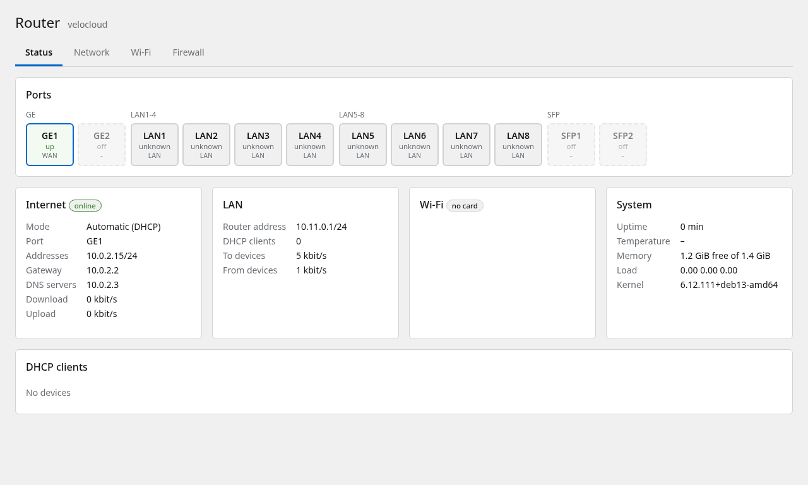

# VeloCloud Edge 520 as a Debian router, with a web interface

Turns a **VeloCloud Edge 520** into a **Debian 13** router with every port working
and a web interface for the LAN, the Internet connection, the Wi-Fi and the
firewall. Underneath it is plain Debian: `apt`, systemd, DKMS, nothing forked.

> **Status: experimental.** Developed on one unit: EDGE520, board rev 2.8 (Atom C2358,
> 4 GB, QCA988x Wi-Fi), Debian 13.7 with kernel 6.12.111. The Edge 540 uses the same
> board design but is untested. Rev A boards (DMI board version 1.x) wire the WAN
> PHYs differently and are not supported for GE1/GE2. No warranty: the network
> driver is kernel code.
>
> **Tested on the box:** cold boot, LAN1-8 (link per jack, traffic on both switches),
> GE1 as DHCP WAN with NAT and the fast path, the watchdog, the logo LED, the web
> interface, apply/confirm and the automatic rollback, the Wi-Fi Enterprise
> authentication (FreeRADIUS checked with `eapol_test`), install to the internal disk.
> **Not tested yet:** the Wi-Fi access point over the air, GE2 and the SFP cages with
> traffic, static WAN, PPPoE and WAN VLANs against a real provider, IPv6 towards the
> LAN, the blue USB 3 ports.



*The status page, here in the QEMU test VM: it has no switches, so the LAN jacks show
"unknown". More: [network](docs/screenshots/network.png) ([Italian](docs/screenshots/network-it.png)),
[Wi-Fi](docs/screenshots/wifi.png), [firewall](docs/screenshots/firewall.png), [LED](docs/screenshots/led.png).*

## What you get

- **All 12 ports.** LAN1-8 (two Marvell 88E6176 switches, run as plain switches),
  GE1/GE2 (Marvell 88E1514 PHYs) and SFP1/SFP2 (Intel I350). Stock Linux only
  drives the SFP cages on this box.
- **Web interface** (a Cockpit page called *Router*, English and Italian):
  - status: link and speed of every jack, Internet, LAN, DHCP and Wi-Fi clients, traffic;
  - network: role of each port, WAN by DHCP, static address or PPPoE, with optional
    VLAN (e.g. 835 for many Italian fibre lines) and MTU, IPv6, LAN address, DHCP
    range and fixed addresses;
  - Wi-Fi: 2.4 or 5 GHz, channel and width, WPA2/WPA3 with a password or
    WPA2/WPA3-Enterprise with one account per person;
  - firewall: access from the Internet and port forwarding;
  - LED: colour of the front logo (previewed live on the box) and switch-off at night.
- **Safe changes.** Every change is applied with a countdown: if you do not confirm
  it within 90 seconds (because the new LAN address or a wrong port role cut you
  off), the router goes back to the previous settings by itself. A change that was
  never confirmed is also dropped if the box reboots.
- **Wi-Fi Enterprise** with FreeRADIUS on the box: its own certificate authority,
  per-user accounts, PEAP-MSCHAPv2, TTLS and EAP-TLS. It is meant to be pointed at an
  Active Directory domain later.
- **Firewall** with nftables, NAT, port forwarding and a software fast path
  (flowtable) for established connections.
- The **front logo RGB LED** in any colour, optionally off at night, the Atom **hardware watchdog**
  driven by systemd, the **serial console** on the mini-USB jack (GRUB menu included).
- **Kernel updates** stay safe: the network driver is rebuilt by DKMS, and if that
  fails GRUB keeps booting the previous kernel, so the ports never disappear.

## Install

1. Download `velocloud-520-debian-*.img.xz` from the
   [Releases](https://github.com/lori28167/velocloud-520-debian/releases) and check its
   SHA-256.
2. Write it to a USB stick of 4 GB or more:
   ```sh
   xz -dc velocloud-520-debian-*.img.xz | sudo dd of=/dev/sdX bs=4M conv=fsync status=progress
   ```
3. Plug the stick into the **black USB 2 port** of the box, connect a PC to any of
   LAN1-8 and power on. SeaBIOS boots USB before the internal disk (F12 opens the
   boot menu). The mini-USB console (115200 8N1) is optional.
4. Open **https://10.11.0.1/** (the certificate is self-signed), log in as **root**
   with the password **velocloud**: you are asked to choose a new one right away.
   Then open *Router* in the menu.
5. When you are happy with it, install it on the internal disk (the 7.3 GB
   "Generic Ultra HS-COMBO"; this erases it) from a terminal, e.g. Cockpit's
   *Terminal* page:
   ```sh
   velocloud-install
   ```
   then power off, remove the stick and power on. Keep the stick as a rescue system.

Defaults: WAN = GE1 (DHCP), LAN = LAN1-8 = 10.11.0.1/24 with DHCP, Wi-Fi off, GE2 and
the SFP cages off, nothing reachable from the Internet.

## Using it

**Web:** https://10.11.0.1/ → *Router*. Edit, press **Apply**, check that everything
still works, press **Keep changes**.

**Command line:** the whole configuration is one file, `/etc/velocloud/router.json`.

```sh
velocloud-apply --check FILE                      # validate
velocloud-apply --set FILE --rollback-after 90    # apply, undone unless confirmed
velocloud-apply --confirm                         # keep it
velocloud-apply --rollback                        # go back now
velocloud-status                                  # live state as JSON
wifi-user add NAME | del NAME | list              # Wi-Fi Enterprise accounts
velocloud-led color purple | color 0 128 255      # logo colour, kept in router.json
velocloud-led on | off                            # by hand, until the next night switch
```

Do not edit the files `velocloud-apply` generates (systemd-networkd `*-vc-*` files,
`/etc/dnsmasq.d/velocloud.conf`, `/etc/nftables.conf`, `/etc/hostapd/hostapd.conf`,
the PPPoE peer): they are rewritten from `router.json`.

**SSH** accepts keys only. Add yours in Cockpit (*Accounts* → root → *Authorized
public SSH keys*) or in `/root/.ssh/authorized_keys`.

**LEDs:** colour and night hours live in `router.json` (`"led"`); the raw LEDs are
`/sys/class/leds/velocloud:{red,green,blue}:logo/` (`brightness` 0-255, or a `trigger`
such as `heartbeat` or `netdev`, until the next scheduled change). **Per-jack link:**
`/sys/devices/platform/velocloud-edge5x0/ports`.

## Wi-Fi

The Qualcomm Atheros QCA988x mini-PCIe card some units ship with is driven by
`ath10k`, which supports access point mode. It has **one radio**: 2.4 **or** 5 GHz. For
both at once, put a second card (e.g. an AR9380/AR9580, `ath9k`) in the free
mini-PCIe slot; that is not wired into the interface yet. Screw the antennas on
before switching the radio on.

**Enterprise:** the first time the Enterprise Wi-Fi is applied, the box creates its
own CA and a certificate for `radius.<organization>.lan`. Add users on the Wi-Fi page.
On the devices: security WPA2/WPA3-Enterprise, EAP method **PEAP**, phase 2
**MSCHAPv2**, CA certificate = the one you download from the Wi-Fi page (on Android
install it as a *Wi-Fi certificate* and give the domain shown on the page), identity
= the user name. iPhone, Mac and Windows show the certificate on the first connection:
compare its fingerprint with the one on the page. Domain-joined Windows 11 PCs with
Credential Guard cannot reuse the Windows login for PEAP-MSCHAPv2: the user types the
password, or you move to EAP-TLS. Joining an Active Directory domain (winbind) is
planned, not done.

## Updates

`apt update && apt full-upgrade` as on any Debian. When a new kernel comes in, DKMS
rebuilds the `velocloud-igb` module for it; `/etc/kernel/postinst.d/zzz-velocloud-igb`
keeps GRUB on the running kernel if that failed.

## This box

| Jack | Interface | Hardware |
|---|---|---|
| LAN1-4 | `lan14` | Marvell 88E6176 switch B behind Intel I354 function 1 |
| LAN5-8 | `lan58` | Marvell 88E6176 switch A behind I354 function 0 |
| GE1 | `ge1` | Marvell 88E1514 PHY behind I354 function 2 |
| GE2 | `ge2` | Marvell 88E1514 PHY behind I354 function 3 |
| SFP1 / SFP2 | `sfp1` / `sfp2` | Intel I350 |
| Wi-Fi | `wlan0` | mini-PCIe slot on bus 02 |

Switch port map: LAN1=B1 LAN2=B0 LAN3=B3 LAN4=B2 LAN5=A2 LAN6=A0 LAN7=A1 LAN8=A3. Each
group of four jacks shares one 1 Gbit/s link to the CPU.

- **Console:** the mini-USB jack is a CP2102N wired to **COM2** (`ttyS1`), 115200 8N1.
- **Watchdog:** coreboot arms the Atom TCO watchdog (about 3 minutes); systemd keeps it
  fed (`RuntimeWatchdogSec=30s`).
- **Disk:** the internal disk is a 7.3 GB card behind a USB card reader. Boot from the
  black USB 2 port. The blue USB 3 ports (TI TUSB7340) are untested here: the OpenWrt
  port needed an xHCI fix for them on 6.12, which this image does not carry.

## How it works

- `driver/` builds the `velocloud-igb` DKMS module: Debian's own `igb` driver, plus the
  OpenWrt port's `200-igb-velocloud-edge5x0.patch` (unchanged; it recognises the board,
  forces the SerDes links to the switches and reroutes the WAN PHY access), plus
  `300-igb-velocloud-board.patch` and `igb_vc_board.c`. Debian's kernel has no
  `gpio-ich`, `mdio-gpio`, `i2c-gpio` or `leds-pca963x`, so `igb_vc_board.c` drives the
  SoC GPIOs directly: the bit-banged MDIO bus to the WAN PHYs (registered as `gpio-0`,
  the name the OpenWrt code looks for), the PCA9557 that holds the PHYs in reset, the
  two switches (brought up as plain switches), the PCA9634 logo LED and the per-jack
  link file. The module replaces `igb` and also drives the I350 SFP ports as usual.
- `rootfs/` is copied into the image: interface names, the `velocloud-*` tools, the
  Cockpit page (`usr/share/cockpit/velocloud`), systemd units, udev rules.
- `build-image.sh` builds the image with `mmdebstrap` in a Debian container;
  `tools/qemu-test.sh` boots it in QEMU laid out like the box and `tools/ui-test.py`
  drives the web interface with Playwright.

## Building

```sh
docker build -t vc-debian-build -f Dockerfile.build .
docker run --rm --privileged -v "$PWD:/w" vc-debian-build /w/build-image.sh /w/out/velocloud-520-debian.img
```

Optional: `-e ROOT_HASH='$6$...'` (a `crypt` hash) sets root's password instead of the
expired `velocloud`; `-e SSH_KEY="$(cat ~/.ssh/id_ed25519.pub)"` adds an SSH key.

## Credits

- The igb patch and most of what is known about this hardware come from
  [velo540openwrt](https://github.com/gallops-gannets/velo540openwrt), the OpenWrt
  port for the Edge 520/540, which documents VeloCloud's GPL Linux sources.
- The people in the [modlog.net VeloCloud 520 thread](https://modlog.net/velocloud-520-to-opensource/)
  who mapped this box first.
- Sibling project: [velocloud-520-opnsense](https://github.com/lori28167/velocloud-520-opnsense),
  the same ports for OPNsense/FreeBSD.
- Debian, Cockpit, FreeRADIUS, hostapd, dnsmasq, nftables.

## License

GPL-2.0-only (see `LICENSE`); the Linux `igb` sources keep their own GPL-2.0 headers.
Unofficial project, not affiliated with or endorsed by VeloCloud, VMware, Broadcom or
Debian. VeloCloud is a trademark of its owner; Debian is a registered trademark of
Software in the Public Interest, Inc.
